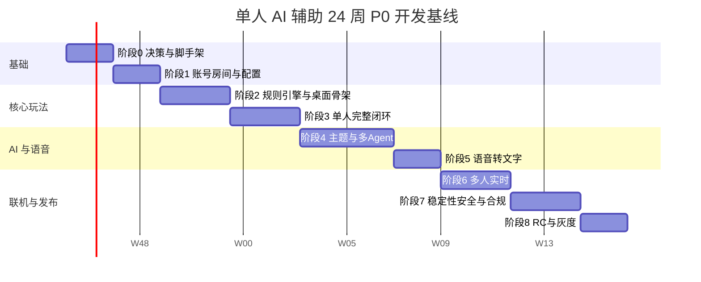

# 角色扮演多智能体狼人杀

## 总体开发计划

| 项目 | 内容 |
| --- | --- |
| 计划版本 | v2.0 |
| 需求基线 | `PRD.md` v1.1 |
| 开发模式 | 1 名开发者 + AI 编程助手，客户端与服务端独立工程 |
| 基线周期 | 全职投入约 24 周，不含微信平台审核和灰度观察期 |
| 交付目标 | 完成 P0 单人 AI 对局与真人/AI 混合好友房，进入微信小游戏灰度 |
| 当前工程状态 | 阶段 2 核心闭环已完成，准备进入阶段 3 的 AI 策略与角色发言，详见 `IMPLEMENTATION_STATUS.md` |

> 本文件只负责总体路线、跨端依赖、联调节点和发布节奏。具体实现分别查看客户端计划、服务端计划和集成契约，避免一份文档同时承载两个工程的细节。

---

## 1. 文档结构

| 文档 | 作用 | 主要读者/使用场景 |
| --- | --- | --- |
| `PRD.md` | 产品范围、规则、交互、质量和验收基线 | 产品决策、验收结果核对 |
| `DEVELOPMENT_PLAN.md` | 阶段、周次、依赖、联调节点和发布门槛 | 日常排期与跨端协调 |
| `CLIENT_PLAN.md` | 微信小游戏场景、页面、交互、网络、录音和真机测试 | 开发客户端工程时 |
| `SERVER_PLAN.md` | API/WSS、规则引擎、AI、ASR、数据库、安全和运维 | 开发服务端工程时 |
| `INTEGRATION_CONTRACT.md` | REST、事件、快照、错误码、名称规则和联调检查 | 两端接口变更和联调时 |
| `IMPLEMENTATION_STATUS.md` | 已完成功能、接口、测试结果、当前限制和下一步 | 每次阶段收尾和接手开发时 |

使用原则：

1. 先读本文件确认当前阶段和依赖。
2. 写客户端功能时以 `CLIENT_PLAN.md` 为主，接口以 `INTEGRATION_CONTRACT.md` 为准。
3. 写服务端功能时以 `SERVER_PLAN.md` 为主，同样以契约为边界。
4. 任何跨端字段、枚举和事件变更，先更新契约，再修改两端。
5. 不用两份子计划各自复制一套产品范围；共同事实只保留在 PRD 和契约中。

---

## 2. 单人开发模型

本计划按 **1 名开发者全职投入、使用 AI 辅助编码和测试** 估算，基准工作量约 120 个开发人日，折算为 24 周。

| 主体 | 负责内容 |
| --- | --- |
| 你 | 需求取舍、技术决策、Prompt 设计、代码合并、测试证据、真机验收、微信审核和发布决策 |
| AI 助手 | 生成代码草稿、解释错误、补充测试、生成 Mock、审查边界、整理文档 |

以下工程中的“客户端”“服务端”“AI”等称谓只表示技术模块，不代表多人分工。

如果每周只能投入约 20 小时，建议按 42～48 周估算。AI 可以加快编码，但不会自动减少规则验证、真实设备测试、多人联调和平台审核所需时间。

多人验收需要多个微信测试账号和设备，可由体验用户参与；不需要建立开发团队。

---

## 3. 工程边界

### 3.1 客户端工程

详见 `CLIENT_PLAN.md`。

- 微信小游戏原生 TypeScript + Canvas 启动层；当前环境未安装 Cocos，正式视觉需求明确后再通过 ADR 决定是否引入。
- 页面、对局展示、输入、录音、WebSocket、重连和体验优化。
- 只展示服务端裁剪后的玩家状态。
- 不实现规则判定、角色分配、AI 策略和私有信息过滤。

### 3.2 服务端工程

详见 `SERVER_PLAN.md`。

- Node.js LTS + TypeScript 的模块化单体服务。
- REST、WebSocket、规则引擎、Agent、主题生成、ASR 代理和数据持久化。
- 托管数据库、Redis、对象存储；P0 不拆微服务。
- 规则和状态为唯一权威。

### 3.3 共享契约

详见 `INTEGRATION_CONTRACT.md`。

- REST API 与 WebSocket 事件。
- 房间、游戏、身份和快照结构。
- 私有信息可见范围。
- AI 结构化输出和 Reviewer 错误枚举。
- ASR 会话流程。
- 背景角色名与席位号使用规则。
- 契约版本与兼容规则。

---

## 4. 总体排期

日期仅用于显示相对周次，不扣除法定假日。启动后应按实际投入重排日历，并至少保留 2 周风险缓冲。

| 阶段 | 周次 | 工作量 | 客户端里程碑 | 服务端里程碑 | 联调节点 |
| --- | --- | ---: | --- | --- | --- |
| 0 | W1～W2 | 10 人日 | C0 工程与连接骨架 | S0 服务、数据库与契约 | CP0 基础连通 |
| 1 | W3～W4 | 10 人日 | C1 登录与房间配置 | S1 鉴权、房间、配置 | CP1 建房 |
| 2 | W5～W7 | 15 人日 | C2 对局桌面与快照 | S2 规则引擎与权限快照 | CP2 规则快照 |
| 3 | W8～W10 | 15 人日 | C3 单人完整交互 | S3 对局编排与最小 AI | CP3 单人整局 |
| 4 | W11～W14 | 20 人日 | C4 背景与角色展示 | S4 主题与多 Agent | CP4 双身份 |
| 5 | W15～W16 | 10 人日 | C5 录音与转写编辑 | S5 ASR 代理与清理 | CP5 语音 |
| 6 | W17～W19 | 15 人日 | C6 好友房与重连 | S6 多人实时与托管 | CP6 混合局 |
| 7 | W20～W22 | 15 人日 | C7 客户端加固 | S7 服务端安全与运维 | CP7 全链路故障 |
| 8 | W23～W24 | 10 人日 | C8 微信发布候选 | S8 生产候选与灰度 | CP8 发布 |

---

## 5. 阶段说明

### 5.1 阶段 0：决策、环境与脚手架

**目标**：确定两端技术栈、外部供应商、域名和契约，使空工程可以端到端连通。

客户端重点：

- 微信小游戏项目、Canvas 启动层、安全区、HTTP/WSS 封装、错误组件。
- 开发环境健康检查、Mock 开关、构建和真机启动。

服务端重点：

- API/WSS、数据库、Redis、迁移、日志和部署基线。
- 契约 v0、统一错误、DS/ASR Provider 骨架。
- 密钥注入和最小权限。

**阶段门**：CP0 通过；客户端可以收到服务端测试事件；两端包和仓库无密钥。

### 5.2 阶段 1：登录、房间与配置

**目标**：完成微信登录、创建单人/好友房、配置人数与角色。

客户端重点：

- 首页、单人/好友房切换、总人数、角色数量、推荐模板。
- 配置错误、保存冲突和未开局恢复。

服务端重点：

- 微信登录、会话、Room/Seat/RoomConfig、房主权限。
- 人数与角色牌堆双重校验、乐观锁。

**阶段门**：CP1 通过；非法配置被拒绝；重复保存不产生重复席位。

### 5.3 阶段 2：规则引擎与桌面骨架

**目标**：没有大模型时，规则引擎也能完成可复现对局，客户端可用快照展示棋盘。

客户端重点：

- 6～12 人桌面、身份揭示、阶段、行动、票型、时间线基础组件。
- 基于服务端快照的客户端状态机。

服务端重点：

- 角色分配、夜晚能力、白天发言顺序、投票、平票、猎人、屠边胜负。
- 事件序号、状态版本、幂等、玩家视角快照、RandomLegalBot。
- 10,000 局规则模拟。

**阶段门**：CP2 通过；固定种子可重放；模拟无死锁；普通快照不含他人游戏角色。

### 5.4 阶段 3：单人完整闭环

**目标**：1 名真人 + 多名 AI 通过真实客户端完成整局。

客户端重点：

- 夜间行动、等待、AI 流式发言、白天文本、投票、结算、基础复盘。
- 断线和事件去重。

服务端重点：

- 单人对局 Orchestrator、最小 Strategy/Dialogue Agent、AI 回合推进。
- 结构化输出校验、DS 超时降级、基础审计和复盘。

**阶段门**：CP3 通过；6/9/12 人整局可完成；DS 故障不卡局；至少 30 局 E2E。

### 5.5 阶段 4：主题与多 Agent

**目标**：用户自定义背景和角色，AI 同时正确进行游戏并有稳定背景人格。

客户端重点：

- 背景输入、指定角色、阵容预览、删除补位、重新生成。
- 双身份身份页、长角色名布局、AI 角色名展示。

服务端重点：

- Theme Pack Agent、角色卡 Schema、唯一名称映射、内容安全。
- Strategy/Persona/Dialogue/Reviewer 多 Agent、记忆和复读控制。
- AI 禁止使用席位编号的确定性审校。
- 30 角色、5 世界观、100 场景评测。

**阶段门**：CP4 通过；角色名唯一；AI 首次指代使用背景角色名；名称违规 0；私有信息泄漏 0。

### 5.6 阶段 5：语音转文字

**目标**：真人可录音、上传、转写、编辑并确认发言。

客户端重点：

- 麦克风授权、录音状态、上传、转写编辑和失败降级。

服务端重点：

- ASR Session、音频校验、临时存储、转写代理、内容安全和自动清理。

**阶段门**：CP5 通过；原始音频不进入长期存储、复盘和 AI 上下文；ASR 故障时文字仍可完成。

### 5.7 阶段 6：多人实时

**目标**：真人可以邀请好友并用 AI 补位，断线后能恢复当前对局。

客户端重点：

- 房间码、微信分享、等待房、准备、事件序列和重连。

服务端重点：

- 真人席位、AI 补位、WSS 广播、服务端计时、幂等、快照恢复和 AI 托管。

**阶段门**：CP6 通过；5 真人 + 4 AI 至少 10 局无阻塞；重复事件不重复结算；越权读取为 0。

### 5.8 阶段 7：稳定、安全与合规

**目标**：把“能玩通”提升到“可以灰度”。

客户端重点：

- 真机适配、弱网、长时间对局、隐私、页面性能、埋点和错误处理。

服务端重点：

- 规则与 AI 质量、DS/ASR 故障注入、权限、限流、快照、备份、监控和成本。

**阶段门**：CP7 通过；PRD 核心验收通过；私有信息泄漏 0；名称违规 0；故障可降级。

### 5.9 阶段 8：发布与灰度

**目标**：冻结 P0，完成生产配置、体验版、监控和回滚。

客户端重点：

- 正式候选包、微信审核材料、真机回归、隐私和分享配置。

服务端重点：

- 生产迁移、密钥、额度、监控、告警、备份与回滚演练。

**阶段门**：CP8 通过；两端契约版本一致；P0/P1 阻塞缺陷为 0；具备灰度扩大和回滚条件。

---

## 6. 跨端依赖

| 上游能力 | 使用方 | 解锁条件 | 若未完成 |
| --- | --- | --- | --- |
| 健康检查与 WSS 握手 | 全部页面 | CP0 | 客户端继续用 Mock 开发 UI |
| 登录与房间 API | 配置页面 | CP1 | 不开始正式对局联调 |
| 稳定快照与规则接口 | 游戏桌面 | CP2 | 不用本地状态临时实现规则 |
| AI 流式发言事件 | 单人闭环 | CP3 | 可用固定文本事件验证 UI |
| 主题草稿 API | 阵容页面 | CP4 | 不把 AI 背景当已完成 |
| ASR Session | 录音页面 | CP5 | 文字输入继续作为降级路径 |
| 好友房与事件恢复 | 多人页面 | CP6 | 不开放多人入口 |
| 生产配置与监控 | 发布 | CP8 | 不提交正式审核 |

跨端实现顺序：

1. 契约确定。
2. 服务端提供可测试的 Mock 或真实接口。
3. 客户端接入并进行契约测试。
4. 真实服务端联调节点。
5. 故障路径验证。
6. 更新三份计划状态。

---

## 7. 联调节点

`INTEGRATION_CONTRACT.md` 为每个联调节点提供字段和错误码。总计划只跟踪结果：

| 节点 | 结果 | 不通过的后果 |
| --- | --- | --- |
| CP0 | 客户端可通过 HTTPS/WSS 连通服务端 | 不进入正式业务开发 |
| CP1 | 可创建配置合法房间 | 不开始规则 E2E |
| CP2 | 服务端规则快照可被客户端展示 | 不开始单人 AI 闭环 |
| CP3 | 1 真人 + 多名 AI 可完成整局 | 不开始自定义主题 |
| CP4 | 双身份、人物名和私有信息规则成立 | 不进入语音阶段 |
| CP5 | 语音可转写、编辑和确认 | 不把语音功能标记完成 |
| CP6 | 好友房与 AI 补位可完成 | 不进行多人发布 |
| CP7 | 故障、安全和性能达标 | 不进入发布候选 |
| CP8 | 版本、环境、监控和回滚就绪 | 不发布 |

---

## 8. 测试与质量门

### 8.1 跨端测试

| 类型 | 责任结果 |
| --- | --- |
| 契约测试 | 两端字段、枚举、错误码完全一致 |
| 快照权限测试 | 每个角色/阶段不能越权获取私有游戏字段 |
| 规则模拟 | 固定种子和随机合法行动，无非法结算 |
| AI 评测 | 行动合法、人物一致、名称正确、无私有信息泄漏 |
| E2E | 单人整局、语音、好友房、断线和结算 |
| 故障注入 | DS、ASR、Redis、数据库和 WSS 异常 |
| 真机 | iOS/Android、小屏、切后台、锁屏和权限拒绝 |
| 性能 | 客户端启动、服务端响应、AI 首字、快照恢复 |
| 安全 | 密钥、日志、越权、重放、Prompt Injection 和限流 |

### 8.2 不可删除的质量门

- 规则引擎固定种子与异常状态测试。
- 玩家视角私有信息过滤测试。
- AI 背景角色名唯一映射和席位编号禁用。
- DS/ASR 失败降级。
- 原始音频清理和隐私说明。
- 多人重连、幂等与快照恢复。
- 真机回归和发布回滚演练。

---

## 9. 单人 AI 辅助流程

每实现一个功能，按以下顺序执行：

1. 从 PRD 复制需求 ID 和验收标准。
2. 在总计划确认当前阶段与联调节点。
3. 在契约中确认请求、响应、事件和错误码。
4. 在对应子计划中勾选本次要实现的任务。
5. 让 AI 先列出改动范围、边界和测试，不直接生成整套系统。
6. 一次只实现一个可验证切片，人工检查安全与状态逻辑。
7. 运行类型检查、单元测试、契约测试和规则模拟。
8. 启动真实服务端、做接口联调和真机验证。
9. 让 AI 作为审查者寻找遗漏，但最终结果由本人判断。
10. 记录测试证据、更新计划和契约版本后提交。

AI 不得直接使用生产密钥、用户音频、真实 openid 或未脱敏日志，也不能代替规则裁决、真机测试和发布决策。

---

## 10. 风险与调整

| 风险 | 触发条件 | 调整方式 |
| --- | --- | --- |
| 单人时间中断 | 生病、工作冲突或连续两周低于计划 | 启用 2～4 周缓冲，优先保住单人闭环 |
| AI 生成代码产生隐藏回归 | 一次跨多个模块或只测正常路径 | 缩小改动、补失败路径和人工审查 |
| 缺少独立 QA | 只有自测和自动测试 | 每阶段真机清单，多人阶段邀体验用户 |
| 两端契约漂移 | 客户端或服务端单独改字段 | 停止联调，先更新契约与两端测试 |
| DS 未按期可用 | 第 6 周仍无额度 | 使用结构化 Mock 继续，真实 AI 顺延 |
| ASR 未按期确定 | 第 14 周仍无账号 | 文字输入继续可用，语音阶段顺延 |
| 多 Agent 延迟过高 | 完整发言 p95 超 10 秒 | 合并表达阶段、减少上下文和模型 |
| AI 成本超预算 | 单局成本超目标 | 减少夜间调用、限制上下文、用更小模型 |
| 多人复杂于预期 | 持续出现竞争和重复结算 | 暂停非 P0 范围，先完成快照和幂等 |
| 微信审核变化 | 内容或资质不满足 | 降低外部生成依赖、增加兜底 |

---

## 11. P1 与当前不做

P0 灰度稳定后再评估：

- 预置世界观库。
- 守卫、白痴等扩展角色。
- 警长竞选和警徽流。
- AI 难度、完整阅读/加速偏好。
- 战绩长图和更细复盘。

当前明确不做：

- 好友观战。
- 赛季、排行榜、成就、赛事。
- AI 语音播报。
- 真人实时语音聊天。
- 支付、抽奖和现金奖励。
- 用户编写并执行任意角色技能代码。

---

## 12. 启动清单

- [ ] 确认 24 周全职基线或 42～48 周轻量投入，并预留至少 2 周缓冲。
- [ ] 将客户端和服务端放在独立工程中，分别建立版本和发布记录。
- [ ] 以 `INTEGRATION_CONTRACT.md` 作为唯一跨端接口依据。
- [ ] 准备 DS API 测试账号、额度、模型名和密钥管理方式。
- [ ] 准备 ASR 账号、测试额度和 60 秒测试音频。
- [ ] 确认微信小游戏 AppID、开发者/体验者、域名和对象存储。
- [ ] 确认默认规则档案和 P0 角色集合。
- [ ] 将“AI 用背景角色名、禁用席位编号”加入 Prompt、Reviewer、接口和验收测试。
- [ ] 将 CP0～CP8 配置为一个端到端回归套件。
- [ ] 每个阶段结束生成阶段报告，记录客户端任务、服务端任务、契约变更和测试证据。
