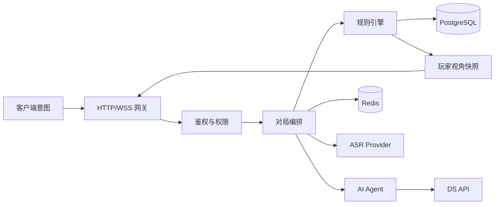

# 服务端与 AI 编排开发计划

| 项目 | 内容 |
| --- | --- |
| 计划版本 | v1.0 |
| 适用工程 | API、WebSocket、游戏规则、多 Agent、ASR 代理与数据服务 |
| 需求基线 | `PRD.md` v1.1 |
| 总计划 | `DEVELOPMENT_PLAN.md` |
| 接口基线 | `INTEGRATION_CONTRACT.md` |
| 客户端计划 | `CLIENT_PLAN.md` |
| 开发模式 | 本人独立开发，AI 辅助编码与测试 |
| 基线周期 | 与总计划一致，全职约 24 周 |

> 本文只描述服务端工程。所有游戏状态、角色分配、行动结算、私有信息裁剪和 AI 上下文均由服务端控制。客户端只能提交意图并读取被裁剪后的快照。

---

## 1. 服务端范围

### 1.1 负责内容

- 微信登录、会话、用户身份和访问控制。
- 房间创建、邀请码、席位、真人/AI 补位和准备状态。
- 确定性狼人杀规则引擎。
- 游戏快照、私有信息过滤、行动、发言、投票和复盘。
- WebSocket 实时事件、计时器、幂等和断线恢复。
- 背景主题生成、背景角色池、名称映射和内容审核。
- DS API 适配、多 Agent 编排、Prompt、结构化输出和评测。
- ASR Session、音频临时存储和转写代理。
- PostgreSQL 持久化、Redis 短期状态、监控、日志和部署。

### 1.2 不负责内容

- 微信小游戏页面渲染、动画、录音交互和音频格式选择。
- 用大模型代替规则引擎判定死亡、票数或胜负。
- 公开其他玩家的私有游戏角色。
- 好友观战、赛季、排行榜、成就、赛事。
- AI 语音播报、真人实时语音聊天、支付和赛事系统。

### 1.3 服务端原则

1. 规则引擎是游戏真相的唯一来源。
2. AI 行动必须经过合法性校验后才会改变状态。
3. 每个玩家只能拿到位于其信息权限内的快照。
4. 模型失败、超时和非法输出不得阻塞对局。
5. 客户端提交的任何用户、席位、角色和阶段字段都不可直接信任。
6. AI 公开发言必须使用 `speech_reference_name`，不能使用席位编号。
7. 原始录音不进入长期数据库、复盘记录或模型上下文。

---

## 2. 技术结构

### 2.1 基线

- Node.js LTS + TypeScript。
- 模块化单体服务，API 与 WSS 可同进程运行，P0 不拆微服务。
- Fastify 提供 HTTP API；原生 WebSocket 提供房间/对局事件。
- PostgreSQL 保存权威状态、事件与复盘。
- Redis 保存短期房间状态、会话、在线状态、幂等键和限流。
- ORM/查询层可自选变更敏感度低且 SQL 可控的方案，关键事务使用显式 SQL。
- DS 和 ASR 均通过 Provider Adapter 接入。
- 托管数据库、Redis 和对象存储，避免单人维护复杂基础设施。
- 本地无 Docker 时使用 SQLite 适配器；推荐通过 `server/compose.yaml` 启动 PostgreSQL，正式部署必须使用 PostgreSQL。

### 2.2 建议目录

```text
src/
  bootstrap/          配置、日志、依赖注入、生命周期
  auth/               微信登录、会话、访问控制
  rooms/              房间、席位、邀请、准备
  game/
    engine/           纯规则引擎
    actions/          夜间行动、投票、发言
    snapshots/        玩家视角构建与信息裁剪
    replay/           复盘与事件重放
  agents/
    orchestrator/     阶段与 AI 回合编排
    strategy/         游戏策略
    persona/          背景人格
    dialogue/         公开发言合成
    reviewer/         规则、信息、名称与内容审校
    memory/           AI 私有和公共记忆
  themes/             主题生成、Schema、名称映射、兜底
  speech/             ASR Session、音频清理和代理
  realtime/           WSS、事件序列、广播和重连
  moderation/         文本与音频内容安全
  observability/      日志、指标、Trace 和告警
  persistence/        migrations、repositories、seed
tests/
  unit/
  contract/
  simulations/
  evals/
  security/
```

### 2.3 数据主线



---

## 3. 里程碑总览

| 阶段 | 周次 | 服务端目标 | 主要交付 |
| --- | --- | --- | --- |
| S0 | W1～W2 | 服务、数据库、日志、契约和外部适配器骨架 | 可连接客户端的基础服务 |
| S1 | W3～W4 | 登录、房间、配置校验 | 可保存合法房间配置 |
| S2 | W5～W7 | 确定性规则引擎与快照 | 可无 AI 完成模拟对局 |
| S3 | W8～W10 | 单人对局编排与最小 AI | 1 真人 + 多名 AI 可完成 |
| S4 | W11～W14 | 主题生成与完整多 Agent | 双身份、人物名和无泄密发言 |
| S5 | W15～W16 | 语音转写代理与音频清理 | 真人语音输入闭环 |
| S6 | W17～W19 | 多人实时、重连和 AI 托管 | 5 真人 + 4 AI 稳定完成 |
| S7 | W20～W22 | 安全、性能、成本、合规和运维加固 | 达到发布候选质量 |
| S8 | W23～W24 | 生产配置、发布和灰度 | 服务端生产候选 |

---

## 4. 阶段 S0：基础服务与契约

**周期**：W1～W2。
**联调节点**：CP0。

### 4.1 工程基础

- [ ] 初始化 TypeScript 服务工程、严格类型检查、Lint、格式化和测试。
- [ ] 建立配置加载与多环境变量：本地、测试、预发布、生产。
- [ ] 建立结构化日志、请求 ID、WSS 连接 ID 和错误处理。
- [ ] 建立 Fastify HTTP 入口和健康检查。
- [ ] 建立原生 WebSocket 服务、握手鉴权、心跳和连接清理。
- [ ] 建立 PostgreSQL 连接、迁移和测试数据库。
- [ ] 建立 Redis 连接和 Key 命名规范。
- [ ] 建立 CI：安装、类型检查、测试、迁移检查、镜像构建。
- [ ] 建立云开发/测试环境部署说明。
- [ ] 完成微信 AppID、HTTPS/WSS 域名和对象存储映射检查。

### 4.2 契约基础

- [ ] 根据 `INTEGRATION_CONTRACT.md` 定义统一响应、错误码和事件信封。
- [ ] 定义房间、席位、游戏阶段、游戏角色、可见范围的共享枚举。
- [ ] 定义 API 和 WSS 版本规则。
- [ ] 建立契约测试，确保字段和枚举变更可被发现。
- [ ] 定义密钥注入方式；DS/ASR/数据库凭据不进入代码和日志。

### 4.3 Provider 骨架

- [ ] 实现 `ModelProvider`：普通生成、结构化生成、超时、重试和 usage 记录。
- [ ] 实现 `AsrProvider`：音频上传、转写、错误分类和 Mock Provider。
- [ ] 实现内容审核 Provider 接口。
- [ ] 用一条测试 Prompt 调用 DS，验证输出 JSON、超时和错误。
- [ ] 用一段测试音频调用 ASR，验证格式、上传和返回。

### 4.4 交付物

- 可部署的 API/WSS 服务。
- 数据库迁移与 Redis 连接。
- HTTP/WSS 契约 v0。
- DS/ASR/审核 Provider 骨架。
- 密钥与环境配置说明。
- CI 与健康检查。

### 4.5 阶段门

- 客户端可以完成健康检查和 WSS 测试事件。
- 服务端在无外部模型时正常启动。
- CI 在干净环境完成构建与测试。
- 仓库、镜像和日志中没有明文密钥。
- DS/ASR 接口至少各完成一次真实测试调用。

---

## 5. 阶段 S1：登录、房间与配置

**周期**：W3～W4。
**联调节点**：CP1。

### 5.1 登录与会话

- [ ] 实现 `wx.login` code 换取服务端会话。
- [ ] 实现 User 数据、内部用户 ID、登录态续期与失效。
- [ ] HTTP 与 WSS 共用用户鉴权。
- [ ] 建立基础限流、登录失败日志和异常码。
- [ ] 用户资料只保存产品必需字段。

### 5.2 房间

- [ ] Room、Seat、RoomConfig、Invite 的数据库迁移。
- [ ] 创建单人房和好友房。
- [ ] 默认 9 人，总人数 6～12。
- [ ] 真人席位、AI 席位和总席位校验。
- [ ] 席位号唯一、席位所有者唯一、AI 背景角色占位。
- [ ] 房间状态 `CONFIGURING / READY / IN_GAME / ENDED / CLOSED`。
- [ ] 房间配置读取、修改和 `version` 乐观锁。
- [ ] 未开局退出和再次进入恢复。
- [ ] 房主权限与房间成员校验。

### 5.3 角色配置校验

- [ ] 角色牌堆必须与总人数完全相等。
- [ ] 至少 1 名狼人、至少 1 名非狼人。
- [ ] 狼人/村民可多个，预言家/女巫/猎人最多 1 个。
- [ ] 6～12 人推荐模板。
- [ ] 服务端拒绝所有客户端绕过参数。
- [ ] 保存配置审计版本。

### 5.4 契约接入

- `POST /v1/auth/wechat`。
- `POST /v1/rooms`。
- `GET /v1/rooms/{room_id}`。
- `PATCH /v1/rooms/{room_id}/config`。
- `room.updated`。

### 5.5 测试与交付

- [ ] 所有角色配置组合和边界值测试。
- [ ] 房主/非房主权限测试。
- [ ] 乐观锁和重复保存测试。
- [ ] 房间快照脱敏测试。
- [ ] 提交登录、房间与配置 API。

### 5.6 阶段门

- 客户端可创建并恢复 6～12 人单人房。
- 非法人数和角色配置均被服务端拒绝。
- 重复请求不产生重复房间或席位。
- 非房主不能修改房间配置。
- API 契约与客户端实现一致。

---

## 6. 阶段 S2：确定性狼人杀规则引擎

**周期**：W5～W7。
**联调节点**：CP2。

### 6.1 纯规则包

- [ ] 定义可序列化 `GameState`、`PlayerGameState`、`Phase`、`Action` 和 `GameEvent`。
- [ ] 使用密码学安全随机源和持久化种子洗牌、分配角色。
- [ ] 6～12 人角色分配与审计。
- [ ] 夜晚顺序：狼人 → 预言家 → 女巫 → 死亡合并 → 猎人 → 胜负检查。
- [ ] 狼人队友信息隔离。
- [ ] 预言家查验结果只写入该玩家私有账本。
- [ ] 女巫解药/毒药、不能自救、每瓶一次。
- [ ] 猎人被狼人击杀/放逐可开枪，被毒杀不可。
- [ ] 白天死亡公告、遗言、发言顺序。
- [ ] 投票、弃票、平票再投、再平无人出局。
- [ ] 连续技能结束后检查屠边胜负。
- [ ] 为守卫保留扩展点，但不启用 P0 守卫。
- [ ] 所有行动校验角色、阶段、存活、目标、资源和次数。
- [ ] 固定种子重放结果一致。

### 6.2 状态与事件

- [ ] 每个状态迁移递增 `state_version`。
- [ ] 每条事件分配全局递增 `sequence`。
- [ ] 所有写操作要求幂等键。
- [ ] 游戏状态按阶段持久化，关键行动立即落库。
- [ ] 支持从快照和事件恢复。

### 6.3 玩家视角快照

- [ ] 公共信息：席位、背景角色、存活、阶段、公开发言、公开票型、死亡公告。
- [ ] 当前玩家自己的游戏角色、私有技能结果。
- [ ] 狼人只在自身为狼人时看到狼人队友。
- [ ] 未公开预言家查验不进入响应。
- [ ] 对局结束后才可返回全员真实游戏角色。
- [ ] 序列化层和数据库层都做字段白名单，不只依赖界面隐藏。

### 6.4 动作接口

- [ ] 夜间行动统一入口。
- [ ] 预言家查验。
- [ ] 女巫用药。
- [ ] 猎人开枪。
- [ ] 投票和弃票。
- [ ] 存活玩家文字发言。
- [ ] 身份揭示确认和游戏开始。
- [ ] 超时弃权与受服务端时间控制的阶段推进。

### 6.5 规则模拟

- [ ] 实现 RandomLegalBot。
- [ ] 实现 Game Runner 自动完成对局。
- [ ] 至少执行 10,000 局随机合法对局。
- [ ] 检查死锁、非法行动、重复死亡、无效阶段迁移和不能结束的局。
- [ ] 固定种子回放校验。

### 6.6 交付物与阶段门

交付物：

- 纯 TypeScript 规则引擎。
- 规则测试套件和模拟器。
- 权限裁剪快照。
- 行动、投票和基础发言接口。
- 10,000 局模拟报告。

阶段门：

- 6、9、12 人规则全部可无 AI 完成。
- 同一随机种子产生相同结果。
- 模拟对局无死锁和非法结算。
- 普通玩家快照不包含其他玩家游戏角色。
- 规则测试完全不依赖 DS/ASR。

---

## 7. 阶段 S3：单人对局编排与最小 AI

**周期**：W8～W10。
**联调节点**：CP3。

### 7.1 对局编排

- [ ] Game Orchestrator 推进身份、夜晚、白天、投票、结算。
- [ ] AI 席位自动行动，真人席位等待输入或超时。
- [ ] AI 行动与真人行动写入统一事件队列。
- [ ] AI 回合显示开始、流式文本和结束事件。
- [ ] 轮到真人时暂停阶段，超时后按规则处理。
- [ ] 计算阶段截止时间并持久化。
- [ ] 重启后恢复未结束对局。

### 7.2 最小 AI 管线

- [ ] 使用固定角色卡验证双身份上下文。
- [ ] Strategy Agent 读取游戏角色、合法目标、公共事实和自己的私有账本。
- [ ] 夜间输出结构化行动目标。
- [ ] 白天输出站边、怀疑、身份声明、投票和说服目标。
- [ ] Dialogue Composer 生成 60～220 字公开文本。
- [ ] 服务端校验 AI 目标后再进入规则引擎。
- [ ] 结构化 JSON 解析失败最多修复一次。
- [ ] 非法目标最多重选一次，之后使用合法兜底。
- [ ] DS 超时、429、5xx 和内容拦截有独立错误分类。
- [ ] AI 全故障时使用模板行动和模板发言。

### 7.3 WebSocket 事件

- [ ] 推送 `game.started`、`phase.changed`、`turn.started`。
- [ ] 推送 `speech.delta` 和 `speech.completed`。
- [ ] 只向合法玩家推送 `private.action_result`。
- [ ] 统一公布 `vote.result` 和 `player.out`。
- [ ] 结束推送 `game.ended`。
- [ ] 客户端落后时触发 `resync.required`。

### 7.4 审计

- [ ] 保存游戏、席位、真实游戏角色、随机种子和规则档案。
- [ ] 保存 AI 行动、模型、Prompt 版本、Token、耗时和降级原因。
- [ ] 保存最终通过审校的 AI 文本，不保存完整 chain-of-thought。
- [ ] 所有私有字段有可见范围。

### 7.5 测试

- [ ] 1 真人 + 5/8 AI 完整对局至少 30 局。
- [ ] DS 正常、超时、非法 JSON、429 和全面故障。
- [ ] 客户端断线后重连。
- [ ] 同一行动重复提交。
- [ ] AI 不引用不存在的游戏事件。
- [ ] AI 不通过席位编号指代玩家。

### 7.6 交付物与阶段门

交付物：

- 单人对局编排器。
- 最小 Strategy + Dialogue + 校验链路。
- AI 流式发言事件。
- 完整对局持久化和基础复盘。
- DS 故障降级。

阶段门：

- 1 名真人 + 多名 AI 可完成 6、9、12 人整局。
- DS 不可用时对局仍能完成。
- AI 非法行动不会进入规则引擎。
- 客户端响应不包含其他玩家游戏角色。
- 至少 30 局 E2E 无卡死或私有信息泄漏。

---

## 8. 阶段 S4：主题与完整多 Agent

**周期**：W11～W14。
**联调节点**：CP4。

### 8.1 主题与角色池

- [ ] 接收背景描述和用户指定背景角色。
- [ ] Theme Pack Agent 输出世界规则和角色卡 JSON。
- [ ] 使用 Schema 校验必填字段、枚举、长度和数组数量。
- [ ] 角色数量覆盖总人数并预留 3 个替补。
- [ ] 生成 `display_name`、`speech_reference_name` 和唯一别名。
- [ ] 全房名称映射去重。
- [ ] 用户指定背景角色不会被分配给 AI。
- [ ] 允许删除候选并补位。
- [ ] 最多重新生成 3 次。
- [ ] 提供最小内置兜底世界观。
- [ ] 主题与角色内容安全检查。
- [ ] 持久化主题版本和角色卡版本。

### 8.2 双身份 Prompt

- [ ] 分层注入绝对规则、世界规则、背景人物、自身游戏角色、可见事实、策略和输出要求。
- [ ] 明确标注用户输入和玩家发言为不可信数据。
- [ ] 每个 AI 只能读取自己的游戏角色和合法私有信息。
- [ ] 背景角色名映射随上下文注入。
- [ ] 禁止任务文本、角色卡和昵称覆盖系统规则。
- [ ] Prompt 版本写入每条 Agent Trace。

### 8.3 多 Agent

- [ ] Strategy Agent：策略、站边、欺骗和投票意图。
- [ ] Persona Actor：人物称谓、语气、关系、时代词汇和口头禅限制。
- [ ] Dialogue Composer：合并策略和人格为公开文本。
- [ ] Reviewer Agent：进行信息、事实、角色、安全和名称审核。
- [ ] 支持将 Persona 与 Composer 合并为一次调用以控制成本。
- [ ] 按问题类型执行重写或模板兜底。
- [ ] 记录调用次数、延迟、Token、成本和降级。

### 8.4 背景角色名硬规则

- [ ] 在游戏创建时冻结 `seat_id -> speech_reference_name`。
- [ ] AI 首次指代玩家必须使用唯一背景角色名。
- [ ] 同段后文允许代词或唯一别名。
- [ ] 扫描阿拉伯数字/中文数字与“号、号位、位”的席位指代。
- [ ] 禁止将 `target_seat`、`seat_no` 或数据库 ID 写入 `public_speech`。
- [ ] 真人历史发言中的席位号可用于理解，但输出必须转成角色名。
- [ ] 不存在、歧义或错误背景角色名拒绝广播。
- [ ] 审校失败码加入 `SEAT_NUMBER_REFERENCE`、`AMBIGUOUS_CHARACTER_REFERENCE`。

### 8.5 AI 记忆与质量

- [ ] 公共事件账本、个人私有账本和最近原文窗口。
- [ ] 较早发言摘要只压缩公开内容。
- [ ] 记录最近两轮开场句、比喻和口头禅，降低复读。
- [ ] 结构化事实优先于摘要。
- [ ] 建立 30 个角色、5 种世界观、100 个场景的评测集。
- [ ] 评测规则合法率、人物识别度、背景一致性、私有信息泄漏、名称准确率和复读率。
- [ ] 对 12 人角色池进行重名与别名压力测试。

### 8.6 交付物与阶段门

交付物：

- 完整主题生成、校验、补位和兜底。
- 双身份 Prompt 和角色卡版本。
- Strategy/Persona/Dialogue/Reviewer 管线。
- 名称映射与席位编号审校。
- AI 质量评测报告。

阶段门：

- 三种以上背景可生成唯一角色阵容。
- AI 发言用背景角色名指代玩家，测试通过率 100%。
- AI 私有信息泄漏为 0。
- Prompt Injection 红队用例通过率 100%。
- 模型失败时主题与对局均有兜底。

---

## 9. 阶段 S5：ASR 与语音服务

**周期**：W15～W16。
**联调节点**：CP5。

### 9.1 客户端录音支持

- [ ] 接收受信任的微信小游戏录音格式；做文件大小、MIME、时长校验。
- [ ] 支持音频格式不一致时由服务端转码或返回明确错误。
- [ ] 麦克风授权由客户端负责，服务端验证会话。

### 9.2 ASR Session

- [ ] 创建 ASR Session，校验用户、席位、房间、阶段和发言权。
- [ ] 上传音频临时保存到对象存储。
- [ ] 调用 ASR Provider，记录耗时和错误码。
- [ ] 返回可编辑转写文本，不直接创建公开发言。
- [ ] 内容安全审核转写结果。
- [ ] 转写完成后删除原始音频。
- [ ] 最长保留 24 小时，配置清理任务处理失败文件。
- [ ] 最终发言通过普通 Speech 接口提交。
- [ ] 音频不进入数据库、复盘、AI Prompt 或日志。

### 9.3 异常与安全

- [ ] 上传中断、重复上传、格式错误和超大文件。
- [ ] ASR 超时、429、5xx 和内容阻断。
- [ ] 过期 Session 和对局已切换阶段。
- [ ] 非当前发言玩家提交。
- [ ] 临时对象访问使用短期签名。

### 9.4 交付物与阶段门

交付物：

- ASR Session API。
- ASR Provider 与 Mock Provider。
- 临时存储和清理任务。
- 语音安全测试报告。

阶段门：

- 客户端可完成语音获取文本并编辑提交。
- ASR 全故障时文字发言正常。
- 原始音频在清理时间后无法读取。
- 非当前发言者不能创建或完成 ASR Session。

---

## 10. 阶段 S6：好友房、实时同步与 AI 托管

**周期**：W17～W19。
**联调节点**：CP6。

### 10.1 好友房

- [ ] 房间码生成、有效期和尝试次数限制。
- [ ] 微信分享邀请参数和加入落地。
- [ ] 玩家加入、离开和席位占用。
- [ ] 房间准备、房主开始、锁定阵容。
- [ ] AI 补位和真人退出后的 AI 托管。
- [ ] 房主转移、未开局踢人和房间关闭。
- [ ] 开局后禁止新加入。
- [ ] 房间码防枚举和限流。

### 10.2 实时事件

- [ ] WSS 广播房间、阶段、发言、投票和结算事件。
- [ ] 每个房间维护独立事件序号。
- [ ] 事件重复提交幂等。
- [ ] 客户端连接落后时返回增量或要求全量快照。
- [ ] 服务端计时器处理行动、发言和投票超时。
- [ ] 广播前按席位、阵营和阶段过滤。
- [ ] 连接断开后保留席位状态。

### 10.3 重连与恢复

- [ ] 会话恢复时确认用户与旧席位一致。
- [ ] 返回最新快照、当前截止时间和自己的合法操作。
- [ ] 错过的私有结果通过快照返回。
- [ ] 不允许重复应用夜间行动、发言或投票。
- [ ] 同一用户新设备登录策略明确，防止一席多控。
- [ ] AI 托管后玩家重连是否恢复控制由配置决定；P0 默认保持 AI 托管到本局结束。

### 10.4 并发与权限

- [ ] 同一阶段并发行动只允许一次状态迁移。
- [ ] 阶段结束后拒绝旧请求。
- [ ] 所有写入校验 room/game/seat 所有权。
- [ ] 任何响应不因传入其他 seat_id 而泄漏私有字段。
- [ ] 普通玩家无法读取其他玩家游戏角色。
- [ ] 客户端非法事件或未知 event type 被服务端忽略。

### 10.5 测试与阶段门

测试：

- [ ] 5 真人 + 4 AI 至少 20 局。
- [ ] 每局 3 次以上断线重连。
- [ ] 同席位双设备登录测试。
- [ ] 乱序、重复、丢失事件测试。
- [ ] 房主离线和其他成员完成对局。
- [ ] 开局后加入、越权读取和重放攻击测试。

阶段门：

- 5 真人 + 4 AI 连续至少 10 局无阻塞。
- 断线后快照恢复正确，重复事件无重复结算。
- 任意玩家无法越权读取他人私有游戏角色。
- 真人退出后 AI 托管可让对局继续。
- 无观战接口和观战事件。

---

## 11. 阶段 S7：安全、性能与运维加固

**周期**：W20～W22。
**联调节点**：CP7。

### 11.1 规则与 AI

- [ ] 1,000 局规则不变量测试。
- [ ] 6～12 人全部模板回归。
- [ ] AI 100 场景质量评测。
- [ ] AI 角色名唯一性和禁用席位编号 100% 测试。
- [ ] Prompt Injection、身份泄露、伪造系统消息红队。
- [ ] AI 复读、错误背景知识和越界内容抽检。

### 11.2 可靠性和降级

- [ ] DS 超时、限流、非法 JSON、内容拦截和全故障。
- [ ] ASR 超时、限流、格式异常和全故障。
- [ ] 数据库短暂不可用、Redis 不可用和 WSS 断开。
- [ ] 服务重启后恢复未完成对局。
- [ ] 模型调用最大次数、Token 和单局成本限制。
- [ ] 熔断、恢复和降级事件记录。

### 11.3 安全

- [ ] JWT/会话签名和过期。
- [ ] 每个 HTTP/WSS 写接口做用户、房间、席位、阶段和版本校验。
- [ ] 快照字段白名单，禁止直接序列化数据库对象。
- [ ] 房间码、登录、ASR 和主题接口限流。
- [ ] SQL 注入、超长 JSON、数组深度、文件类型和重放。
- [ ] 日志脱敏、密钥扫描和访问最小权限。
- [ ] AI Prompt 中私人数据和用户输入边界。

### 11.4 性能

- [ ] 房间创建/加入 p95 ≤ 1 秒。
- [ ] 普通操作提交 p95 ≤ 500 ms。
- [ ] AI 首字 p95 ≤ 2.5 秒。
- [ ] AI 完整发言 p95 ≤ 10 秒。
- [ ] 快照恢复 p95 ≤ 3 秒。
- [ ] Mock DS 条件下测试 100 个并发房间、每房 9 席位。
- [ ] 观察数据库连接池、Redis 命中率、WSS 连接数和事件积压。

### 11.5 数据、内容安全与运维

- [ ] 状态、事件、Agent Trace 和指标定义。
- [ ] 背景/角色/发言/AI 输出内容安全链。
- [ ] 用户删除历史和隐私政策要求。
- [ ] 数据库迁移、备份和恢复演练。
- [ ] 生产密钥管理、访问权限和回滚。
- [ ] 告警：模型错误、ASR 错误、卡局、私有字段泄漏、事件缺口、成本异常。
- [ ] 对局故障诊断页仅限受权人员。

### 11.6 阶段门

- PRD 第 17 节服务端相关验收全部通过。
- 私有信息泄漏为 0。
- AI 名称指代违规为 0。
- DS/ASR 全故障时对局仍可完成。
- 1,000 局规则模拟无非法结算。
- 备份恢复和回滚演练通过。

---

## 12. 阶段 S8：生产候选与灰度

**周期**：W23～W24。
**联调节点**：CP8。

### 12.1 发布任务

- [ ] 冻结服务端功能，只修复阻塞、安全、数据和严重体验问题。
- [ ] 生产数据库迁移和回滚验证。
- [ ] 配置生产 HTTPS/WSS 域名、DS/ASR 额度和内容审核。
- [ ] 配置密钥、最小权限、限流和预算告警。
- [ ] 完成单机、多人、语音和外部依赖故障回归。
- [ ] 验证新旧客户端 API 版本兼容。
- [ ] 准备关闭 AI、关闭语音、暂停新开局等功能开关。
- [ ] 完成备份恢复和部署回滚演练。
- [ ] 准备运营诊断页、客服查询和日志检索流程。

### 12.2 发布门

- 全部 P0 服务端验收用例通过。
- 没有未关闭的高危越权、隐私或数据完整性问题。
- DS/ASR 故障降级可用。
- 线上监控和告警可定位卡局与模型故障。
- 客户端、服务端和集成契约版本一致。
- 具备服务端回滚方案。

---

## 13. 服务端测试矩阵

| 类型 | 重点 |
| --- | --- |
| 单元测试 | 规则、角色能力、配置校验、快照过滤、名称映射 |
| 契约测试 | REST、WSS、Agent JSON、ASR 响应 |
| 规则模拟 | 固定种子和随机行动，6～12 人 |
| AI 评测 | 人格、背景一致、私有信息、名称和复读 |
| 安全测试 | 越权、Prompt Injection、重放、文件上传、限流 |
| 故障注入 | DS/ASR/Redis/数据库/WSS 异常 |
| 负载测试 | 并发房间、AI 调用、WebSocket 广播和事件积压 |
| 恢复测试 | 服务重启、快照恢复、迁移回滚 |

专项硬要求：

1. 普通玩家响应中不能出现其他人的 `game_role`。
2. AI 公开文本不能出现席位数指代。
3. AI 不能公开未观察到的系统行动。
4. AI 不能直接使用 `target_seat` 作为发言内容。
5. ASR 原始音频不得进入数据库、AI 上下文和复盘。
6. DS 全故障时规则引擎和真人文字对局仍可继续。

---

## 14. 服务端完成定义

- REST/WSS 接口与 `INTEGRATION_CONTRACT.md` 一致。
- 单人和 5 真人 + 4 AI 混合局稳定完成。
- 所有规则、私有信息和胜负结算可审计、可重放。
- 主题生成、多 Agent 发言、角色名映射和兜底完整。
- 语音转写代理可用且原始音频按策略清理。
- DS/ASR/Redis/WSS 故障有明确降级行为。
- 生产监控、告警、备份、回滚和隐私清理已就绪。
- 服务端不包含客户端 UI 逻辑，客户端不承担服务端真相。
